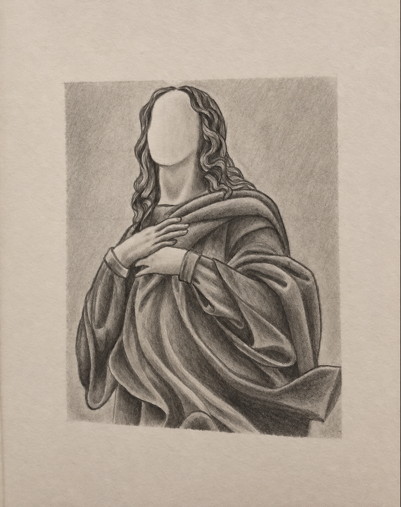
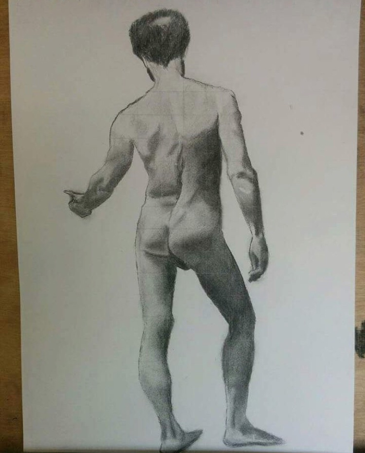
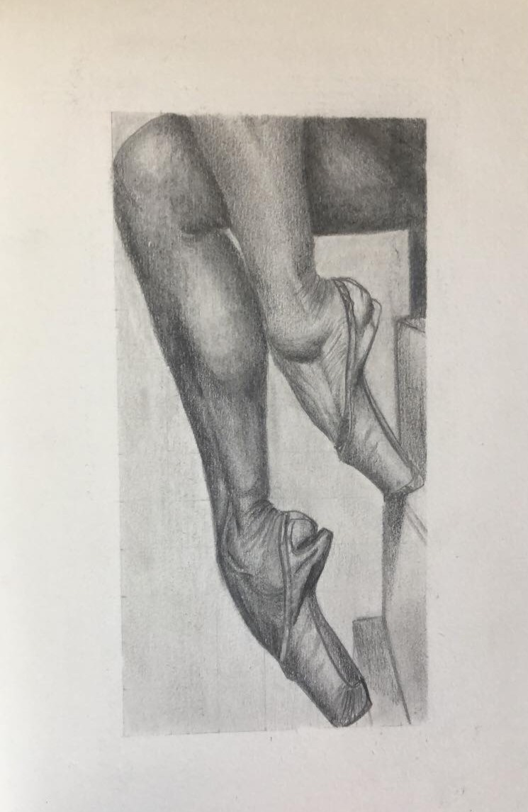
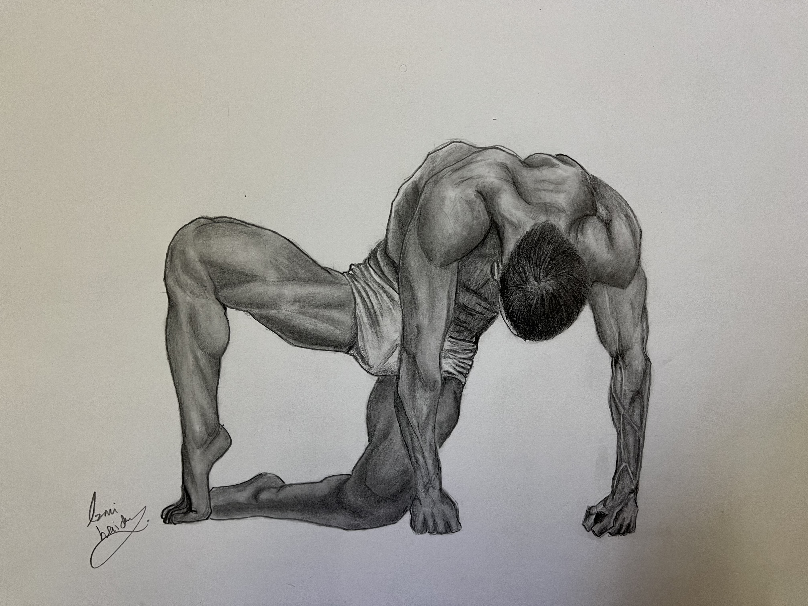
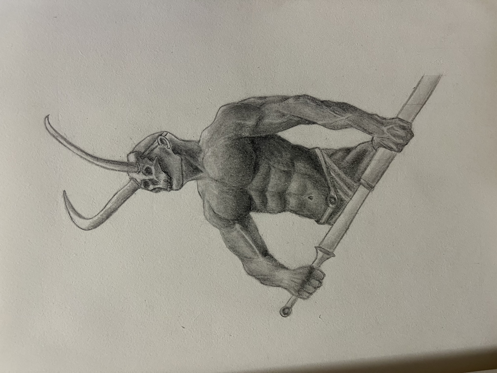
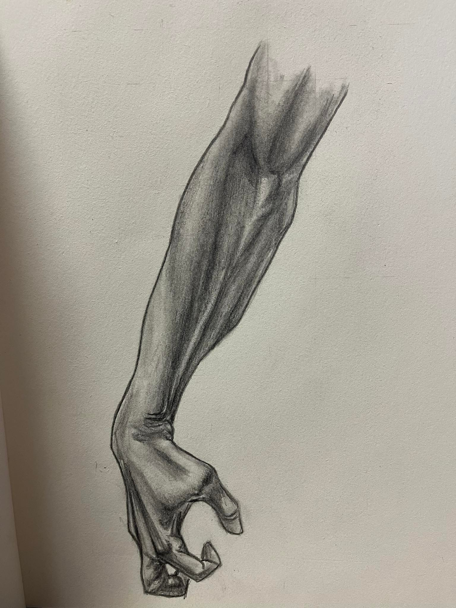
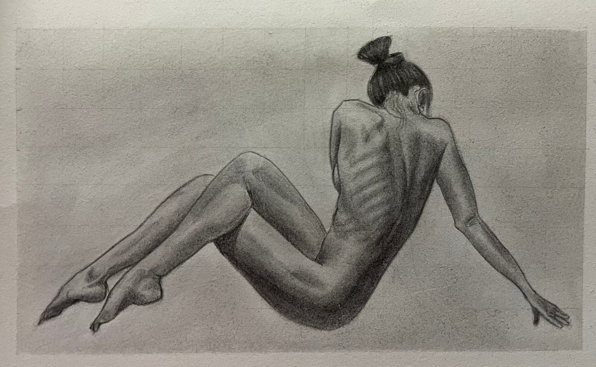
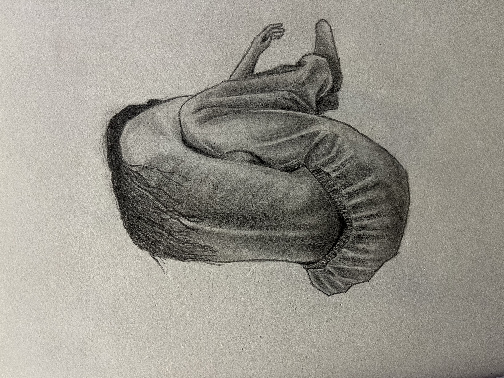
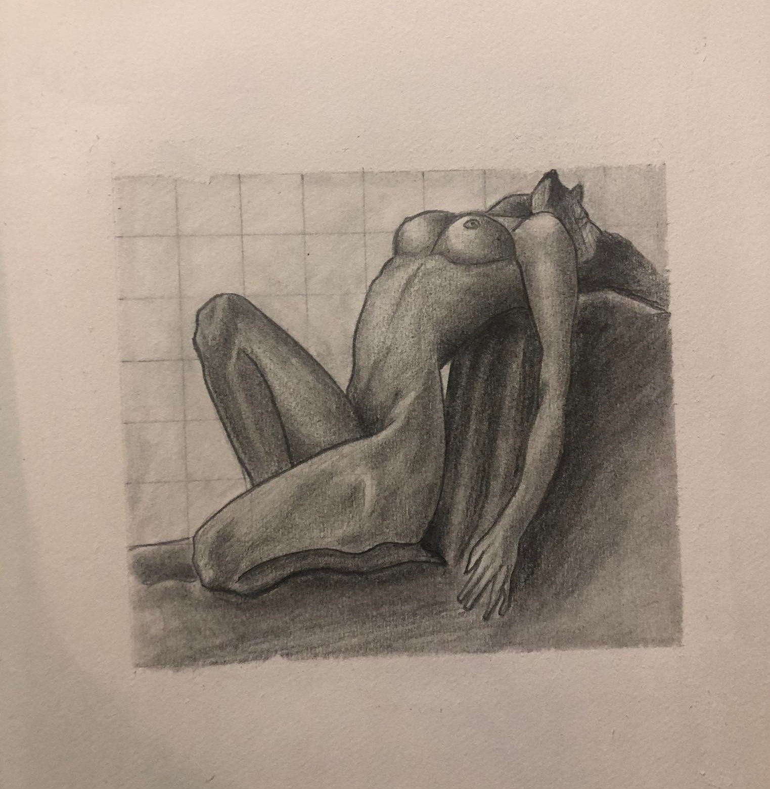

<!doctype html>
<html lang="en">
<head>
<meta charset="utf-8">
<meta name="viewport" content="width=device-width, initial-scale=1">
<meta name="description" content="Studies and drawings in HB, 2B, and 4B graphite.">
<title>Pencil Drawings | Azmi Haider</title>
<link rel="stylesheet" href="/portfolio.css">
<link rel="stylesheet" href="/photography_gallery/gallery.css">
<link rel="stylesheet" href="/theme.css?v=1">

</head>
<body>
<a class="skip" href="#main">Skip to content</a>
<header class="site-header">

<a class="site-name" href="/">Azmi Haider</a>
<nav aria-label="Main navigation"><a href="/">About</a><a href="/research/">Research</a><a href="/cv/">CV</a><a href="/unplugged/">Unplugged</a></nav>

</header>
<main class="photography" id="main">
<a href="/unplugged/">Back to Unplugged</a>
<h1>Pencil Drawings</h1>

Studies and drawings in HB, 2B, and 4B graphite.

<figure></figure>
<figure></figure>
<figure></figure>
<figure></figure>
<figure></figure>
<figure></figure>
<figure></figure>
<figure></figure>
<figure></figure>

</main>
<dialog class="photo-viewer" aria-label="Artwork viewer">

<button type="button" data-previous>Previous</button><button type="button" data-next>Next</button><button type="button" data-close>Close</button>

</dialog>
</body>
</html>
